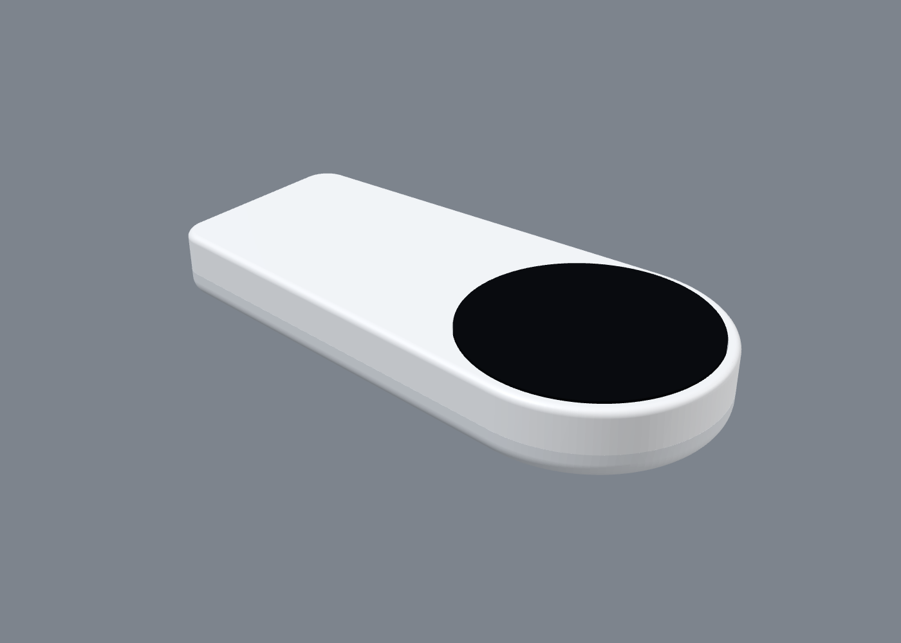

# HA Controller

HA Controller turns the Waveshare ESP32-S3-Touch-AMOLED-1.75, a round AMOLED touch screen, into a Home Assistant remote. A custom integration with a sidebar panel lets you design what the screen shows, and an ESPHome firmware renders it.

- Block map editor in Home Assistant
- Edge-swipe navigation between blocks
- Light and thermostat knobs
- Custom blocks
- Automatic firmware updates

Status: under active development.

See the [documentation](docs/README.md).

## Install

1. Flash the firmware from the web installer: <https://pyxel-dev.github.io/HA-controller/> (Chrome or Edge).
2. In HACS, add the custom repository `https://github.com/pyxel-dev/HA-controller` (type Integration) and install the same version.

See [Getting started](docs/getting-started.md) for the full steps and the [documentation](docs/README.md).

## 3D models

You can find two 3D models, with or without power button, in the [3D_models](3D_models) folder. Each model is available as STL or 3MF.

  
  

